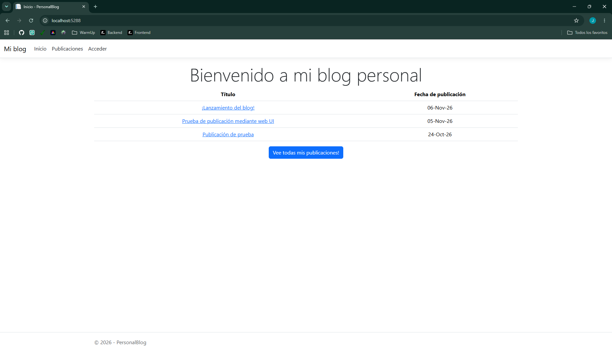
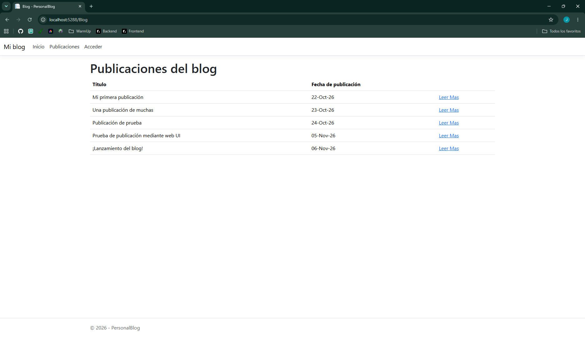
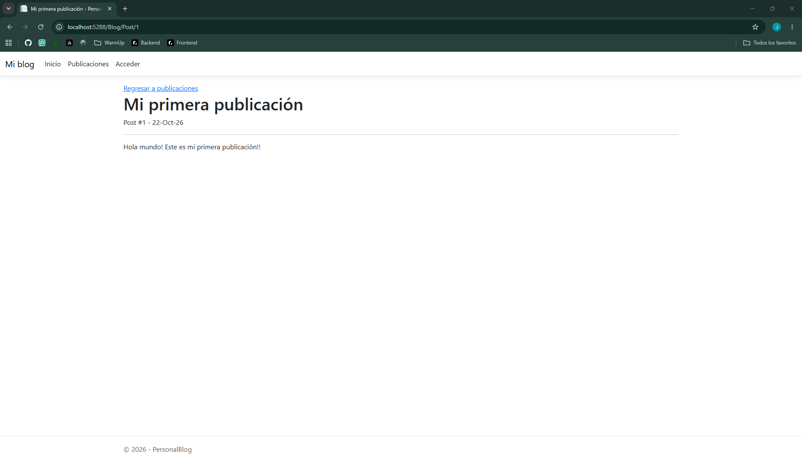
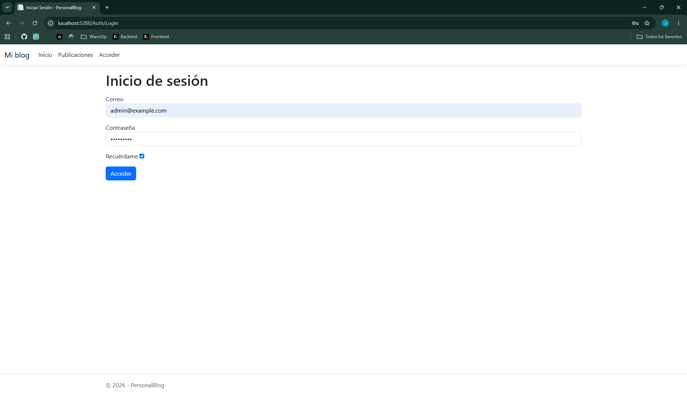
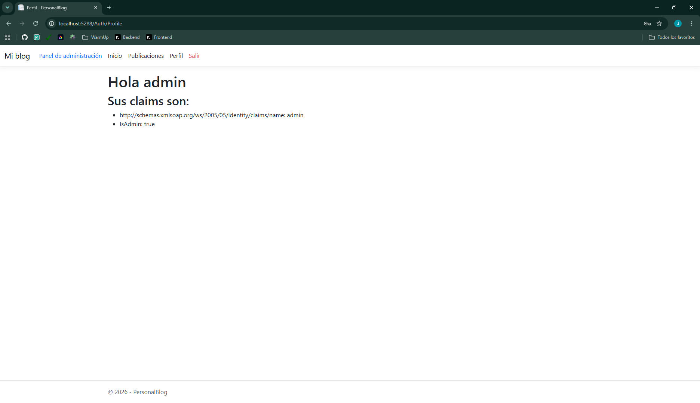
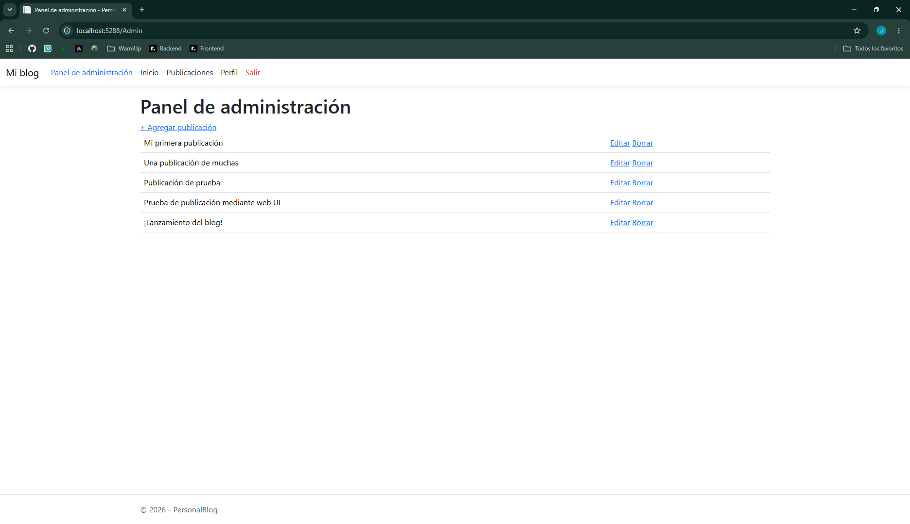
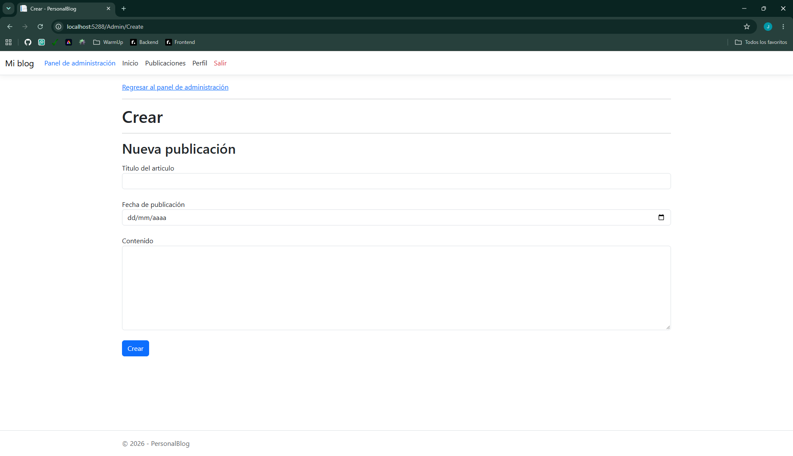
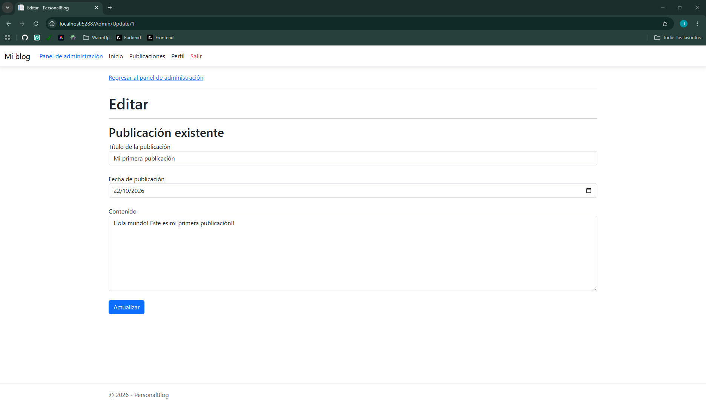
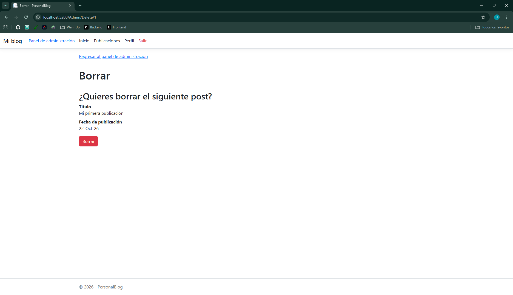

Blog personal
=============

Proyecto creado como uno de los retos de Roadmap.sh

Aplicación de full stack diseñada con .NET 10, html, css y js para resolver el reto de roadmap.sh "[Blog personal](https://roadmap.sh/projects/personal-blog)".

Características
---------------

*   Controladores de ruta
*   Conexión y consulta de bases de datos
*   Validación de datos
*   Autenticación y session mediante cookies
*   Authorization basada en claims
*   Páginas dinámicas
*   Sistema de plantillas para páginas

Instalación
-----------

1.  Clona el repositorio

`git clone https://github.com/juanharodev/juanharodev.github.io.git`
    

* * *

2.  Abre la una terminal y navega hasta la carpeta del proyecto
    
`cd /portfolio/roadmap-sh/backend/06-personal-blog`

* * *

3.  Restaura las dependencias del proyecto
    
`dotnet restore`

* * *

4.  Compila el proyecto
    
`dotnet build`

* * *

5.  Ejecuta la aplicación
    
`dotnet watch`

* * *

6.  Navega al puerto de local host asignado y explora la página
        
`dotnet run`

¿Cómo se usa?
-------------

En la página de inicio podrás ver la publicaciones mas recientes.

En la página de publicaciones podrás ver todas las publicaciones.

En acceder podrás acceder a una cuenta con un correo y contraseña, se hicieron 2 cuentas estáticas,las credenciales para accde son:

*   Cuenta de administrador: correo - admin@example.com, contraseña - admin1234
*   Cuenta de usuario: correo - user@example.com, contraseña - user1234

En la cuenta de usuario podrás acceder a la página de perfil.

En la cuenta de administrador podrás acceder a la página de perfil asi como al panel de administración que permite crear, editar y borrar publicaciones.

### Ejemplo de uso

        